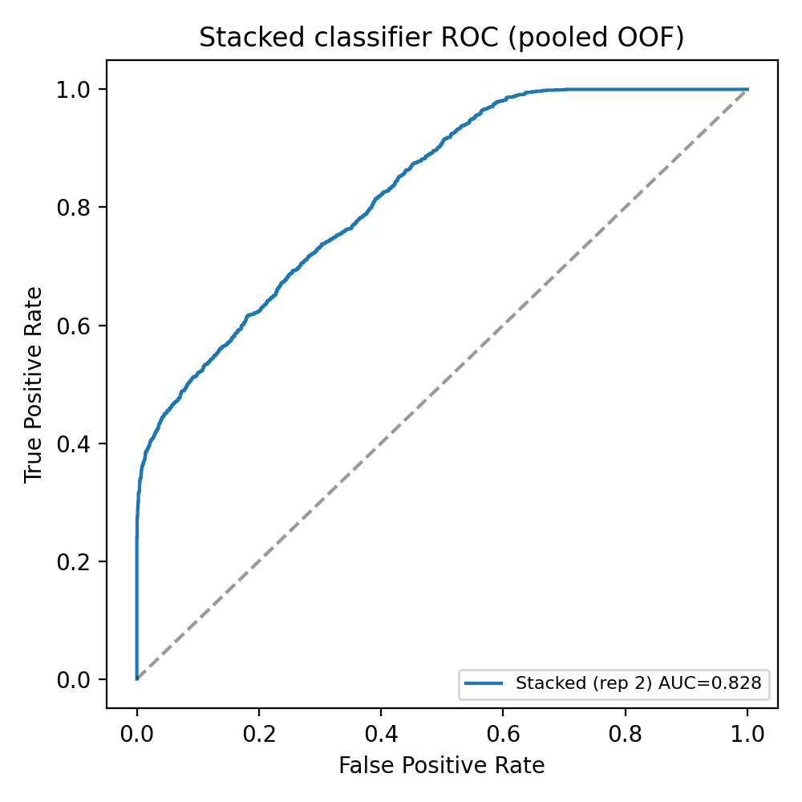
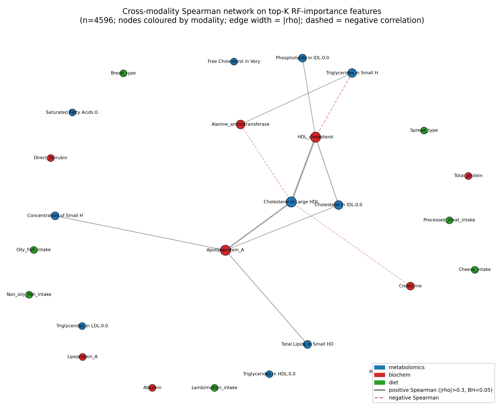

# Multimodal Integration for Colorectal Cancer: Prediction vs Biomarker Discovery

**A reproducible multi-omics pipeline that fuses blood metabolomics, clinical biochemistry, and diet to
classify colorectal cancer (CRC). It separates what data integration adds for prediction from what it adds
for biology.**

`Python` · `R (mixOmics)` · `scikit-learn` · `SHAP` · multi-omics data fusion · explainable AI

The pipeline runs the full lifecycle on one cohort. It audits messy clinical data, chooses fusion strategies
for stated reasons, evaluates with repeated cross-validation, and explains the models. The headline gain
from integration is small, and the writeup reports that plainly rather than overstating it.

---

## TL;DR

- **Data:** UK Biobank-derived cohort, **n = 4,596** (2,327 control, 2,269 CRC), three matched blocks.
  Metabolomics has 50 NMR features, Blood Biochemistry has 8 clinical-chemistry assays, Diet has 8 items.
- **Two integration strategies:** intermediate fusion (DIABLO, regularised CCA) for joint structure, and
  late fusion (per-modality Random Forests into a stacked logistic regression) for prediction.
- **Headline result:** biochemistry alone reaches **AUC 0.824**; late fusion adds only **+0.004 AUC**.
  Integration's value here is biomarker discovery, not a prediction boost.
- **Explainability:** SHAP, a depth-4 surrogate tree, and a cross-modality correlation network converge on
  the same **HDL / Apolipoprotein-A-I axis**, corroborated by verified literature (PubMed PMIDs).

---

## Results at a glance

| Model                               | Strategy                    | AUC (mean ± SD, 5-fold × 3 repeats) |
| ----------------------------------- | --------------------------- | ------------------------------------- |
| RF (biochemistry alone)             | per-modality                | **0.824 ± 0.010**              |
| RF (metabolomics alone)             | per-modality                | 0.565 ± 0.010                        |
| RF (diet alone)                     | per-modality                | 0.512 ± 0.013                        |
| Stacked LR (metab + biochem + diet) | late fusion                 | **0.827 ± 0.009**              |
| Stacked LR (metab + biochem)        | late fusion                 | 0.827 ± 0.009                        |
| DIABLO (mixOmics)                   | intermediate fusion         | BER 0.43, AUC ≈ 0.59                 |
| rCCA (mixOmics), component 1        | intermediate (unsupervised) | canonical ρ =**0.884**         |

<p align="center">
  
  
</p>

*Left: ROC for the stacked late-fusion classifier. Right: cross-modality network. Biochemistry HDL and
ApoA-I features bridge to metabolomics HDL particle subfractions, the same axis the intermediate models
recover.*

---

## The question

Modern cancer cohorts carry several data modalities per patient. Two questions follow:

1. **Prediction.** Does combining modalities classify CRC better than the best single modality?
2. **Discovery.** Does combining modalities reveal coherent, interpretable biology shared across blocks?

This project answers both on the same cohort. The answers diverge. Fusion barely helps prediction, yet it
cleanly recovers shared biology.

## Approach

```
00_eda            distributions, missingness audit, outlier flags
01_preprocessing  inner-join, sentinel recoding, KNN/median imputation, log1p, z-scale
02_intermediate   DIABLO (block sPLS-DA) + regularised CCA   (R, mixOmics)
03_late           per-modality Random Forests, Boruta, stacked LR, igraph network
04_compare        common-vs-distinct features (Venn + ranked overlap tables)
05_xai            SHAP (per-RF + meta-learner) + depth-4 surrogate decision tree
06_clinical       marker to pathway to verified-PMID mapping
testing           sensitivity: 2-modality (omic + non-omic) stack
```

**Design choices** (full rationale in [`analysis/06_clinical/DIFFICULTIES.md`](analysis/06_clinical/DIFFICULTIES.md)):

- **No early/concatenation fusion.** Concatenating 8-D biochemistry with 50-D NMR swamps the clinical block
  on scale and dimensionality. Intermediate fusion preserves block structure; late fusion preserves
  block-specific learners.
- **Imputation matched to each block.** KNN (k=10) for collinear NMR subfractions, per-class median for
  low-cardinality biochemistry, and median for diet after recoding UK Biobank sentinel codes (`-3`/`-1`)
  that would otherwise fake a "negative intake."
- **Outliers flagged, not dropped.** Clinical assays have legitimately long tails; Mahalanobis flags only 2
  to 8% of samples.
- **Repeated stratified CV** (5-fold × 3) with inner-CV hyperparameter selection. Seed 2026 throughout. Full
  grid in [`analysis/tables/hyperparameters.csv`](analysis/tables/hyperparameters.csv).

## What the models learned

- **Late fusion is biochemistry-led.** The stacked meta-learner's SHAP and a depth-4 surrogate tree split
  almost entirely on the biochemistry probability. Metabolomics contributes refinement, not headline signal.
- **Intermediate fusion recovers shared biology.** DIABLO component 1 and rCCA component 1 (ρ = 0.884) both
  load on an HDL / ApoA-I axis present in both blocks. The cross-modality network restates this as a graph,
  linking HDL-cholesterol and ApoA-I to HDL particle subfractions.
- **Verified clinical markers** ([`analysis/tables/markers_clinical.csv`](analysis/tables/markers_clinical.csv),
  every PMID resolved on PubMed):
  - **ApoA-I ↓ in CRC:** circulating biomarker (Murakoshi 2011) and prognostic for PFS/OS (Xie 2024).
  - **HDL-cholesterol ↓ in CRC:** meta-analysis of 17 prospective cohorts, about 1.98M individuals (Yao &
    Tian 2014).
  - **Serum albumin ↓ in CRC:** nutritional and inflammatory axis (Gupta 2021).
  - **Honest null, direct bilirubin:** the RF assigns it importance, but the literature (Monroy-Iglesias
    2021) finds no CRC association. It is reported as a "model says X, evidence says Y" tension rather than
    dropped silently.

## Limitations

Binary label only, with no stage, MSI, or location. The design is cross-sectional, so it shows association
rather than causation. Metabolomics and diet are near-chance standalone learners; Boruta confirms 0/50 and
0/8 features. The fusion gain is small. Proteomics was excluded because it shared zero sample IDs with the
other blocks. These points are documented, not hidden; see [`analysis/SUMMARY.md`](analysis/SUMMARY.md) and
`DIFFICULTIES.md`.

---

## Reproduce

Data is not included; see [Data access](#data-access). With the data in place under `data/`:

```bash
# Python pipeline (see requirements.txt)
python analysis/00_eda/01_load_audit.py
python analysis/01_preprocessing/01_preprocess.py

# Intermediate fusion (R, mixOmics)
Rscript analysis/02_intermediate/run_diablo.R .
Rscript analysis/02_intermediate/run_rcc.R .

# Late fusion + explainability
python analysis/03_late/01_per_modality_rf.py
python analysis/03_late/02_stacked_classifier.py
python analysis/03_late/03_boruta_and_network.py
python analysis/03_late/04_rf_importance_and_network.py
python analysis/04_compare/01_intermediate_vs_late.py
python analysis/05_xai/01_shap_surrogate.py
```

**Environment:** Python ≥ 3.10 (`pip install -r requirements.txt`); R ≥ 4.3 with `mixOmics`
(`BiocManager::install("mixOmics")`). Seed 2026 fixes every random draw. CSV outputs are exported alongside
Parquet for cross-language access.

## Data access

The cohort is derived from the **UK Biobank**, which is controlled-access data. Raw and per-sample derived
files are excluded from this repository (see `.gitignore`) and cannot be redistributed. To reproduce from
scratch, apply for access via the
[UK Biobank Access Management System](https://www.ukbiobank.ac.uk/enable-your-research/apply-for-access) and
place the supplied modality files in `data/`. The committed content (code, aggregate figures, and summary
tables) contains no individual-level records.

## Repository layout

```
README.md                  project overview (this file)
requirements.txt           Python dependencies
analysis/
  README.md                pipeline walkthrough
  SUMMARY.md               detailed results writeup
  00_eda ... 06_clinical/  numbered, ordered pipeline stages
  figures/                 300 dpi result figures (aggregate)
  tables/                  hyperparameters, clinical markers
data/                      (gitignored) UK Biobank inputs, not redistributable
```

## AI assistance

AI tools were used for code suggestions, debugging, and documentation support. The author reviewed, tested,
and takes responsibility for the final code and analysis.

---

*Author: Riya Shet. Analysis completed as part of MSc Health Data Science coursework. This repository is a
cleaned version of an individual project.*
